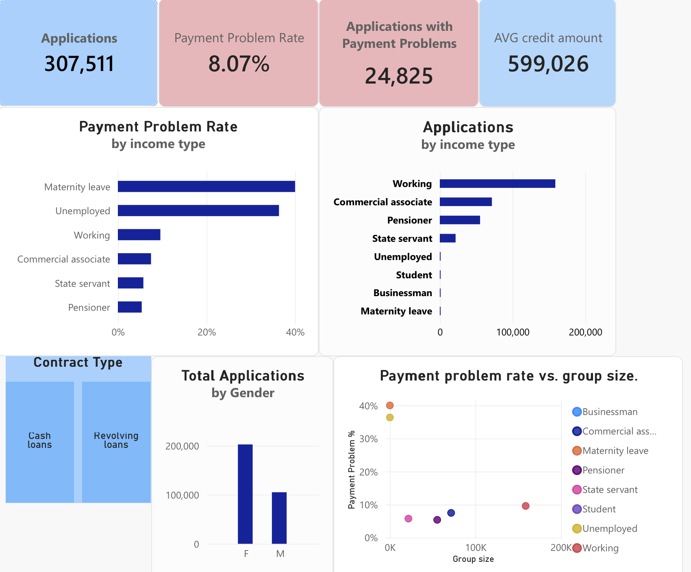

# Credit Risk Analysis

## Overview

This project explores payment problems across applicant groups and
investigates what financial averages hide.

**Main question:** How do payment problem rates vary between applicant
groups, and how should those differences be interpreted alongside
group sizes and financial distributions?

This is a learning project using Snowflake, SQL, Python and Power BI.
Machine learning is a possible future extension.

## Tools and Workflow

| Tool | Purpose |
|---|---|
| Snowflake | Store the source application data |
| SQL | Handles setup and prepare the Power BI export |
| Python and pandas | Validations and financial exploration |
| Power BI | Present key metrics and group comparisons interactively |
| GitHub | Document the analysis and track changes |

The reporting workflow is:

Source CSV → Snowflake → SQL checks and export → CSV in OneDrive
→ Power Query → Power BI report

Python reads financial data from Snowflake for further investigation.

## Dataset

The project uses the application training data from
[Home Credit Default Risk](https://www.kaggle.com/competitions/home-credit-default-risk/data).

- **307,511 applications**
- **122 variables** in the source dataset
- **13 selected columns** in the Power BI export

The source table is stored in Snowflake as:

`HOME_CREDIT.RAW.APPLICATION_TRAIN`

`TARGET` identifies recorded payment difficulties according to
the dataset definition:

- `TARGET = 0`: no recorded payment problems
- `TARGET = 1`: recorded payment problems

## Power BI Report



The image is a static preview of an interactive report.

The report includes:

- Total applications
- Applications with payment problems
- Payment problem rate
- Average credit amount
- Application counts and payment problem rates by income type
- Application counts by gender
- A scatter plot comparing payment problem rate with group size
- A contract type slicer

Group selections allow the metrics to be explored interactively.
XNA gender values are excluded from the gender visual.

**Access:** The interactive report is available for a live demonstration.
Public access is currently restricted by university account settings.

## Project Structure

```text
credit-risk-prediction/
├── sql/
│   ├── 01_setup.sql
│   └── 02_csv_powerBI.sql
├── notebooks/
│   └── 01_data_understanding.ipynb
├── PowerBi/
│   ├── measures.dax
│   └── Screenshots/
│       └── overview.png
├── reports/
│   └── data_analysis.md
├── data/
│   ├── raw/
│   └── processed/
├── .gitignore
├── requirements.txt
└── README.md
```

- **sql:** Snowflake setup, source exploration, report export and validation.
- **notebooks:** Financial distributions and TARGET group comparisons.
- **PowerBi:** Report screenshots and supporting documentation.
- **reports:** Findings, interpretation and limitations.
- **data:** Local data folders; source files and extracts are excluded from Git.

## Explore the Analysis

- [SQL database setup](sql/01_setup.sql)
- [SQL export for Power BI](sql/02_csv_powerBI.sql)
- [Python data understanding and Power BI validation](notebooks/01_data_understanding.ipynb)
- [Detailed findings and limitations](reports/data_analysis.md)

## Key Findings

### Overall Payment Problems

Payment problems are recorded for **24,825 of 307,511 applications**,
giving an overall rate of **8.07%**.

### Group Size Matters

Maternity leave has a payment problem rate of **40%**, but this represents
only **2 out of 5 applications**. A high percentage in a very small group
provides limited evidence for broader conclusions.

### Averages Hide Distribution Differences

The mean credit amount is approximately **599,026**, compared with
a median of **513,531**. Larger credit amounts pull the mean above
the middle value.

### Extreme Income Values Affect Spread

The highest recorded income is **117 million**.

Excluding this observation in a sensitivity check reduces the income
standard deviation by approximately **120,000**. The mean changes only
slightly, while the median remains essentially unchanged.

The original dataset remains unchanged because the observation has
not been confirmed as an error.

### Mean and Median Comparisons Can Differ

Income and credit have higher means and medians for TARGET 0.

Annuity has a higher mean for TARGET 0, but a slightly higher median
for TARGET 1. TARGET 0 also has higher annuities at the 75th and
95th percentiles.

## Data Handling and Validation

- SQL summaries provide reference values for checking Power BI metrics.
- Python checks identify missing financial values.
- The 12 missing annuity values remain missing and are excluded from
  numerical annuity summaries.
- Extreme income values are investigated without changing the source data.
- The Python notebook has been checked by restarting the kernel and
  running all cells.

## Reproducing the Work

### Python Analysis

1. Obtain `application_train.csv` from the dataset source.
2. Load the data into Snowflake as
   `HOME_CREDIT.RAW.APPLICATION_TRAIN`.
3. Create and activate a Python environment.
4. Install the dependencies:

   ```bash
   pip install -r requirements.txt
   ```

5. Create a local `.env` file in the project root containing:

   ```text
   SNOWFLAKE_ACCOUNT=your_account
   SNOWFLAKE_USER=your_username
   SNOWFLAKE_PASSWORD=your_password
   ```

6. Ensure the warehouse, database and schema in the notebook match
   your Snowflake environment.
7. Open `notebooks/01_data_understanding.ipynb` in VS Code, select
   the project environment and run all cells.

The notebook uses `../.env`, so its working directory should be
the `notebooks` folder. Credentials must not be committed to GitHub.

### Power BI Report

1. Run the SQL export query to produce the selected 13 columns.
2. Save the exported CSV in OneDrive.
3. Connect Power Query to the CSV.
4. Promote the headers and verify column types and decimal parsing.
5. Create the measures and visuals in Power BI.
6. Compare the unfiltered report totals with the SQL summaries.
7. Test filters and inspect group sizes alongside payment problem rates.
s
Exact Snowflake loading instructions and Power BI measure documentation
are still being completed.

## Limitations

- The findings describe associations, not causes.
- Very small groups require careful interpretation.
- The validity of the highest income observation is uncertain.
- Annuity summaries exclude 12 missing values.
- Financial units and currency require verification.
- Predictive performance has not been evaluated.
- Public interactive report access is restricted by university settings.


